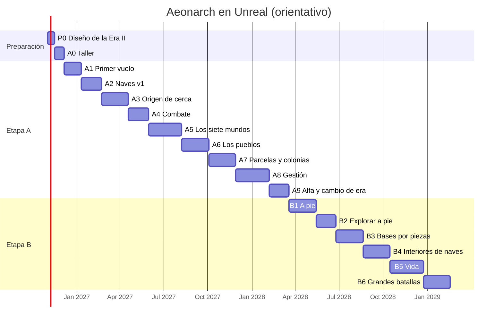

# Aeonarch en Unreal — Mega hoja de ruta

Plan del 23-10-2026, a petición del dueño. Describe **qué juego** se construye en Unreal Engine 5.8.4 y **en qué orden**, con todo el detalle posible. El *cómo* técnico de conectar el cliente al servidor (acceso, protocolo, versión del cliente) está en [migracion-unreal.md](migracion-unreal.md); lo que aquí cambie manda sobre aquel.

> **Estado: plan, nada hecho.** Ningún código de Unreal existe todavía y nada de esto se ha probado. Las cifras son propuestas para que el dueño decida; las estimaciones son orientativas.

## 0. Las decisiones del dueño que guían todo

| Decisión (23-10-2026) | Consecuencia para el plan |
|---|---|
| Todo el juego se reconstruye en **Unreal 5.8.4**: naves, espacio, interfaz, efectos, sonido. | El juego web **se cierra ya** (decisión del 23-10-2026, §16): la Wiki y las páginas legales siguen en línea. El servidor de Hetzner se queda (Node + PostgreSQL, multijugador y Wiki). |
| Lo que debe tener: planetas sin pantallas de carga, cielos de colores, cabina física, naves con peso e interiores caminables. | Son los pilares de la experiencia (§1.3 y §1.4). |
| **No realista, pero precioso.** | Estilo pictórico propio: colores atrevidos, formas legibles, escalas comprimidas. Libera de los problemas de la escala astronómica real. |
| **Un solo sistema solar de 7 planetas.** No hace falta más. | Fuera la galaxia de 30 000 estrellas, el salto entre estrellas y los territorios por sistemas. Todo el juego (colonias, especies, guerra, economía) pasa a ocurrir en un sistema que se puede conocer palmo a palmo. |
| El equipo son **el dueño y Claude**; el dueño no programa ni modela (puede aprender). | **Todo por código**: naves, texturas, shaders, disparos, planetas, interfaz, sonido. Claude trabaja en el ordenador del dueño con Claude Code (§3). |
| Presupuesto: el dueño acepta gastar en Claude lo que haga falta para hacerlo bien. | Se puede permitir iterar mucho el aspecto, con capturas y comparaciones en cada fase. |

---

## 1. Visión

### 1.1 La frase del juego

> **Un único sistema solar, siete mundos y nueve pueblos, y en medio la humanidad, que no se puede extinguir.** Cada Emperador baja a los planetas, reclama tierra, construye, comercia y pelea, muere y vuelve. Todos los jugadores comparten el mismo cielo.

### 1.2 Por qué un solo sistema es mejor para este juego

- **Profundidad en vez de extensión.** Con 30 000 estrellas, casi todas eran puntos de un mapa. Con siete planetas, cada uno puede ser un lugar memorable con su paisaje, su pueblo, su música y sus secretos.
- **Los jugadores se encuentran.** En una galaxia enorme, un servidor pequeño se siente vacío. En un sistema, siempre hay alguien en la órbita de al lado.
- **Es abarcable para dos personas.** Siete planetas hechos con mimo (más sus lunas, un cinturón y una estación) son un objetivo alcanzable; una galaxia precioso no lo es.
- **Encaja con el lore.** La Gran Hostilidad «no necesita una declaración de guerra ni un enemigo único»: aquí todos los pueblos se disputan el mismo sistema.

### 1.3 Los pilares (lo que nunca se recorta)

1. **Belleza en cada encuadre.** Cualquier captura del juego debe valer como fondo de pantalla.
2. **Sin pantallas de carga** entre el espacio, la atmósfera, la superficie y el interior de la nave.
3. **Vuelo que se siente bien**: inercia, peso, sonido, cabina.
4. **El juego sigue sin el jugador** (principio de `docs/diseno.md`): el servidor lo calcula todo.
5. **La muerte no expulsa** (Ley I): se renace y se pierde tiempo, posición y obras (Ley III).

### 1.4 La experiencia que buscamos

| En los mundos | En las naves |
|---|---|
| Despegar y aterrizar sin cortes. | Cabina con instrumentos 3D; levantarse del asiento. |
| Una paleta de color y un cielo propios en cada planeta. | Naves grandes con interiores caminables. |
| Flora y fauna procedurales: descubrir y catalogar. | Peso: masa, inercia, motores que empujan de verdad. |
| Bases construidas por piezas. | Luces de cabina, materiales con desgaste, sonido envolvente. |
| Guardianes que protegen las tierras de cada pueblo. | Estaciones y hangares con vida. |

**Lo que no intentamos**: una cantidad enorme de contenido hecho a mano ni el realismo. Somos dos personas: ganamos con **lo procedural** y con **elegir bien**.

---

## 2. El sistema: siete mundos

> Todo lo de esta sección es una **propuesta** (nombres incluidos) para que el dueño la cambie a su gusto. Los datos vivirán en `packages/content` (regla 4), no en el código.

### 2.1 La estrella: Aeon

Una estrella blanco-dorada, grande en el cielo, con una corona que ondula y destellos lentos. Se puede volar cerca para cosechar plasma (recurso `exotic`), con el calor como peligro (`STAR_HEAT` ya existe). En su cara se ven manchas que cambian con los días.

### 2.2 Los planetas, de dentro afuera

```sistema
[
  {"n":1,"nombre":"Brasa","tipo":"Mundo forja","radioKm":3,"orbitaKm":120,"color":"#ff7a3d","color2":"#3a1a14","pueblo":"Aurelianos","lunas":0,"anillo":false,
   "paisaje":"Cara de día fundida, cara de noche de cristal negro; una franja habitable en el crepúsculo, con ríos de lava y bosques de obsidiana.",
   "juego":"Metales y aleaciones. Arena de duelos de las casas aurelianas («el poder debe demostrarse»). Calor extremo de día."},
  {"n":2,"nombre":"Elyss","tipo":"Mundo cristal","radioKm":4,"orbitaKm":220,"color":"#c79bff","color2":"#2b1f4a","pueblo":"Elydri","lunas":1,"anillo":false,
   "paisaje":"Llanuras de cristal violeta que cantan con el viento, auroras permanentes, ciudades-archivo que brillan bajo el suelo.",
   "juego":"Investigación y lore. Los Elydri cambian conocimiento por recuerdos del Emperador entre vidas."},
  {"n":3,"nombre":"Origen","tipo":"Mundo océano","radioKm":6,"orbitaKm":340,"color":"#4fb6ff","color2":"#0d2a3f","pueblo":"Humanidad (Núcleo Humano)","lunas":1,"anillo":true,
   "paisaje":"Océano turquesa con archipiélagos, nubes altas, un anillo orbital humano que cruza el cielo como una cinta de luz.",
   "juego":"Zona segura (Núcleo Humano). Nacimiento de los Emperadores nuevos, mercado, tesoro de la humanidad, primeras parcelas."},
  {"n":4,"nombre":"Tharax","tipo":"Mundo vivo","radioKm":5.5,"orbitaKm":480,"color":"#7cff6b","color2":"#16301a","pueblo":"Tharaxi","lunas":2,"anillo":false,
   "paisaje":"Selva de hongos gigantes bioluminiscentes, esporas en el aire, colmenas que crecen sobre las montañas.",
   "juego":"Biomasa y química. Peligroso: la colmena se adapta a quien la ataca. Casta disidente aliable."},
  {"n":5,"nombre":"Vesperia","tipo":"Mundo jardín","radioKm":4.5,"orbitaKm":700,"color":"#ffd36b","color2":"#3a2e12","pueblo":"Vesperi","lunas":2,"anillo":false,
   "paisaje":"Praderas doradas, árboles como torres, cielo malva al atardecer, cúpulas defensivas que se encienden si alguien amenaza.",
   "juego":"Santuario: hay que ganarse el permiso para aterrizar. Protectores de colonias humanas… o resistencia contra quien abuse."},
  {"n":6,"nombre":"Céfiro","tipo":"Gigante gaseoso","radioKm":16,"orbitaKm":950,"color":"#ff9ec8","color2":"#3d1830","pueblo":"Nómadas del Vacío (y Carroñeros en el anillo)","lunas":5,"anillo":true,
   "paisaje":"Bandas rosas y crema, tormentas como ojos, un anillo enorme de hielo y roca, ciudades nómadas que flotan entre las nubes.",
   "juego":"Comercio y volátiles (combustible). Los Nómadas comercian; los Carroñeros acechan en el anillo."},
  {"n":7,"nombre":"Umbra","tipo":"Mundo helado y oscuro","radioKm":5,"orbitaKm":1300,"color":"#7fe0ff","color2":"#0a1622","pueblo":"Nihil (y ruinas de los Precursores)","lunas":1,"anillo":true,
   "paisaje":"Hielo azul bajo un sol lejano, geiseres, un anillo roto de los Precursores que lo rodea; zonas donde la luz se dobla.",
   "juego":"Final del juego: anomalías, ruinas, tecnología antigua. Los Nihil distorsionan sensores y luz."}
]
```

### 2.3 Los otros lugares

| Lugar | Dónde | Qué es |
|---|---|---|
| **Ábaco** | Punto de Lagrange L4 de Origen | Estación perfecta de los **Grises**, de geometría exacta y blanca. Diplomacia con condiciones: tecnología o protección a cambio de límites a tu expansión. |
| **El Cinturón** | Entre Vesperia y Céfiro (≈ 800–880 km) | Asteroides de todos los tamaños: minería, escondites de Carroñeros, restos de batallas. |
| **La Grieta** | Más allá de Umbra (≈ 1600 km) | Herida en el espacio por la que llegan los **Erradicadores** en oleadas (crisis del sistema, `CRISES`). |
| **Lunas** | 12 en total | Cada una con un rasgo: la luna de cristal de Elyss; la luna-astillero humana de Origen; las dos de Tharax (una colmena-semilla y el refugio de la casta disidente); las dos lunas guardianas de Vesperia; las cinco de Céfiro (tres de casas nómadas, una carroñera y una helada sin dueño); la luna hueca de Umbra (Precursores). Brasa no tiene. |
| **Restos y anomalías** | Por todo el sistema | Sucesos (`SPACE_EVENTS`), señales de socorro, pecios, ruinas. |

### 2.4 Escala propuesta (no realista, jugable)

| Magnitud | Hoy (cliente web) | Propuesta para Unreal |
|---|---|---|
| Radio de un planeta rocoso | 20–95 km | **3–6 km** (gigante: 16 km) |
| Altura de la atmósfera | proporcional | **25–40 % del radio** (atmósferas gruesas y visibles) |
| Distancia estrella–último planeta | millones de km | **≈ 1300 km** |
| Velocidad de vuelo normal | — | 0–250 m/s (impulso hasta 500) |
| Crucero (pulso) | hasta 1800 km/s | **hasta 15 km/s**, con 5 s de carga |
| De Origen a Tharax | — | ≈ 15–20 s de crucero |
| Cruzar el sistema entero | — | ≈ 2 min de crucero |
| Rodear Origen a pie | — | horas (circunferencia ≈ 38 km) |
| Nave del Emperador | 320 m | **60–90 m** (proporción con planetas de pocos km); naves capitales de 300–600 m |
| Persona | — | 1,8 m |

Con estas escalas, el sistema entero cabe en coordenadas `double` sin trucos raros y la precisión deja de ser el problema principal (lo era con la escala astronómica).

### 2.5 El tiempo en el sistema

- **Rotación**: cada planeta gira (día de 40–90 min reales): hay amaneceres y noches en la superficie.
- **Órbitas**: lentas (de 8 h para Brasa a 4 días para Umbra), calculadas por el servidor en función del tiempo, como hoy `positionAt`. Las alineaciones cambian: a veces Céfiro tapa el sol de una luna.
- **Eclipses**, lluvias de meteoros del Cinturón y tormentas de Céfiro como sucesos visibles.
- El juego sigue en tiempo real (`TIME_SCALE=1`).

### 2.6 Los nueve pueblos en el sistema

| Pueblo | Hogar | Postura hacia la humanidad (lore) | Qué hace el jugador con ellos |
|---|---|---|---|
| Humanidad | Origen y su anillo | — | Base segura, mercado, proyectos comunes. |
| Aurelianos | Fortaleza en el crepúsculo de Brasa | Rivales naturales; vasallaje o duelo | Duelos y torneos, vasallaje temporal a cambio de favores, guerra por las minas. |
| Elydri | Ciudades-archivo de Elyss | Quieren estudiar sus recuerdos | Intercambio de conocimiento (tecnología) por «recuerdos» (registro de muertes y vidas del Emperador). |
| Tharaxi | Colmenas de Tharax | Fascinados; quieren incorporar la reproducción humana | Peligro principal del interior; la casta disidente puede ser aliada. |
| Vesperi | Vesperia y sus lunas | Protectores o resistencia | Reputación: si la ganas, protegen tus colonias; si la pierdes, te expulsan. |
| Nómadas del Vacío | Ciudades flotantes de Céfiro | Comercian con quien respete sus rutas | Mercado, rutas, escoltas; bloquear sus rutas los vuelve hostiles. |
| Grises | Estación Ábaco | Pactos con límites | Tratados: tecnología o protección a cambio de no pasar de N parcelas. |
| Nihil | Umbra y la oscuridad exterior | Unos quieren acabar con la humanidad; otros liberarla | Peligro del final; misterio sobre la naturaleza de los Emperadores. |
| Precursores | Ruinas en todos los mundos; anillo y luna hueca de Umbra | Desaparecidos | Exploración y lore: pistas del origen de los Emperadores. |
| Erradicadores | Llegan por la Grieta | Exterminio | Crisis periódicas que unen (o no) a los Emperadores. Objetivo: Cunas y colonias. |
| Carroñeros | Anillo de Céfiro y el Cinturón | Oportunistas | Piratas: cazarlos, sufrirlos, contratos. |

---

## 3. Dirección artística: «no realista, pero precioso»

### 3.1 El estilo en una frase

> **«Pintura luminosa»**: formas simples y legibles, colores saturados que cambian con la luz, atmósferas gruesas y brillantes, y detalles finos que solo se ven de cerca.

Las referencias de tono las elige el dueño en su tablero (P0): imágenes que marcan la dirección de color, luz y forma, sin copiar ninguna.

### 3.2 Reglas del estilo

1. **Color por mapas de gradiente**, no por texturas realistas: cada superficie toma su color de una rampa (sombra → luz → brillo) definida en los datos del planeta o de la especie. Cambiar la rampa cambia el mundo entero.
2. **La atmósfera tiñe todo**: la niebla de altura toma el color del cielo; las montañas lejanas se funden con él (perspectiva aérea exagerada).
3. **Luz de borde** (*rim light*) en naves y criaturas para que se lean contra cualquier fondo.
4. **Formas grandes, detalles pequeños**: siluetas claras de lejos; paneles, tornillos y grabados solo de cerca.
5. **Brillo con medida**: estelas y disparos brillan, pero el limitador de destellos (fotosensibilidad) manda siempre.
6. **Cada pueblo, su idioma visual** (§3.3), y cada planeta, su paleta (§2.2).
7. **Nada de emojis ni iconos de móvil**: iconos de línea propios, como hoy.

### 3.3 El idioma visual de cada pueblo

| Pueblo | Formas | Materiales | Colores | Luz |
|---|---|---|---|---|
| Humanidad | Líneas limpias, paneles grabados, simetría | Metal claro pintado, vidrio | Blanco hueso, azul profundo, detalles dorados | Cálida dentro, fría fuera |
| Aurelianos | Coronas, aletas como estandartes, picos | Oro pulido, esmalte | Oro, carmesí, negro | Brillo de forja |
| Elydri | Facetas, prismas, crecimiento cristalino | Cristal translúcido con luz interior | Violeta, rosa, blanco | Refracción, arcoíris |
| Tharaxi | Orgánico, costillas, bulbos, simetría radial | Quitina, membranas | Verde ácido, ámbar, negro | Bioluminiscencia que late |
| Vesperi | Curvas, cúpulas, hojas | Cerámica y madera viva | Oro cálido, verde salvia, malva | Escudos como pompas de jabón |
| Nómadas | Remiendos, piezas dispares, velas solares | Chapa reciclada, tela | Óxido, turquesa, colores de tela | Faroles, luces de colores |
| Grises | Geometría perfecta: esferas, cubos, toros | Cerámica blanca mate | Blanco, gris perla, un único azul | Líneas de luz finas y exactas |
| Nihil | Siluetas recortadas, sin detalle visible | Negro que absorbe la luz | Negro absoluto, borde azul eléctrico | Distorsión de la luz a su alrededor |
| Precursores | Imposibles: escaleras que no acaban, anillos | Piedra antigua con vetas de luz | Piedra gris-arena, luz cian | Pulso lento, como respiración |
| Erradicadores | Aristas, hojas, asimetría agresiva | Metal ennegrecido, quemado | Rojo sangre, negro | Rojo intermitente |
| Carroñeros | Chatarra soldada, pintura de guerra | Óxido, parches | Amarillo peligro, óxido | Faros desparejados |

### 3.4 Capturas objetivo

Cada fase entrega **capturas objetivo** hechas desde cámaras fijas del «banco de pruebas visual» (§4.6). El dueño las aprueba antes de pasar de fase, y se guardan para comparar «antes y después». Propuesta de las primeras diez:
1. Origen desde su órbita al amanecer, con el anillo humano.
2. La nave del Emperador de frente, con Aeon detrás.
3. Cabina de noche sobre Tharax.
4. Atardecer en las praderas de Vesperia, a pie.
5. Elyss con aurora, desde la superficie.
6. Céfiro con su anillo, desde una de sus lunas.
7. Combate en el Cinturón: trazadoras y explosiones.
8. Crepúsculo de Brasa: lava y obsidiana.
9. Umbra y el anillo de los Precursores.
10. La Grieta abriéndose y la primera oleada de Erradicadores.

### 3.5 Mínimos técnicos

| Medida | Objetivo |
|---|---|
| GPU de referencia | **AMD Radeon RX 9060 XT de 16 GB** (la del dueño). Se comprobará también que va bien en tarjetas de 8 GB con calidad media. |
| Resolución | 1440p con escalado (TSR); 1080p nativo |
| Fotogramas | 60 fps en el espacio; 45–60 en superficie (30 aceptable al principio de la etapa B) |
| Carga inicial | < 20 s hasta ver el espacio; nada de cargas después |
| Memoria de vídeo | ≤ 8 GB en calidad alta (cabe con holgura en 16 GB); ≤ 6 GB en calidad media |
| Tamaño de la descarga | < 3 GB (casi todo es procedural) |

---

## 4. Cómo trabajamos dos personas

### 4.0 Por ahora, desde la nube (decisión del 23-10-2026)

Hasta el **domingo 25-10-2026** el dueño no tiene cupo de Claude en su ordenador, así que **hasta entonces Claude trabaja solo desde la nube** (estas sesiones de claude.ai/code). Eso cambia el bucle de trabajo:

| Qué | Cómo, desde la nube |
|---|---|
| Escribir el código de Unreal (C++, `.usf`, Python de editor, datos) | Claude lo escribe y lo sube a GitHub. |
| Compilar y probar `AeonCore` (C++ puro: protocolo, fórmulas, terreno, parcelas) | **Sí se puede en la nube**: CMake y g++/clang en Linux, con pruebas y vectores compartidos con TypeScript; también en GitHub Actions. |
| Compilar el proyecto de Unreal y jugarlo | **Lo hace el dueño**: baja los cambios (GitHub Desktop o `git pull`), abre el proyecto (Unreal compila solo al abrirlo) y pulsa *Play*. |
| Errores de compilación | El dueño copia el texto del error (o una captura) en la conversación; Claude lo corrige y vuelve a subir. |
| Ver cómo queda | El dueño manda capturas o vídeos cortos; Claude los mira y propone cambios. |
| Servidor, Wiki, despliegues | Como hasta ahora, desde la nube. |

Para que el dueño tenga que hacer lo mínimo:
- Todo lo que se pueda se escribe en `AeonCore` y se prueba en la nube antes de que el dueño compile nada.
- Cada entrega trae una **lista corta de pasos** («baja los cambios, abre el proyecto, pulsa Play, mira el planeta desde la cámara 3 y mándame una captura»).
- Un botón del menú de depuración del juego guarda **todas las capturas del banco de pruebas** de una vez (§4.6), para mandarlas juntas.
- Compilar Unreal en el contenedor de la nube **no es viable**: no tiene GPU ni Windows, el motor pesa decenas de GB y para Linux habría que compilarlo desde el código fuente.

Desde el domingo, con cupo en el ordenador del dueño, se pasa a §4.1 (Claude Code local) y el ritmo sube mucho. Estos días en la nube sirven para lo que no necesita Unreal: el diseño de la Era II (P0), `AeonCore` y el servidor.

### 4.1 Claude en el ordenador del dueño (más adelante)

En la nube y en Hetzner, Claude no puede compilar ni ejecutar Unreal (no hay Windows, ni GPU, ni editor). Para que el plan funcione sin que el dueño programe, **Claude Code se instala en el ordenador del dueño**, junto a Unreal. Desde ahí Claude puede:

| Capacidad | Cómo |
|---|---|
| Escribir y cambiar el código | C++, HLSL, Python de editor, configuración (`.ini`), datos (JSON). |
| Compilar | Unreal Build Tool desde la línea de órdenes; Claude lee los errores y los corrige sin pasarlos por el dueño. |
| Probar | Pruebas automáticas de Unreal (*Automation Tests*) lanzadas desde la línea de órdenes; pruebas de `AeonCore` con CMake. |
| Mirar | Capturas automáticas desde cámaras fijas del banco de pruebas (§4.6); Claude puede ver las imágenes y compararlas. |
| Manejar el editor | Plugin **MCP** de Unreal (experimental en la 5.8): crear actores, materiales, recursos y niveles, ejecutar pruebas. Escucha solo en `127.0.0.1` y no tiene autenticación, así que no se expone a la red. Si falla, todo sigue siendo posible con C++, Python y la línea de órdenes. |
| Medir rendimiento | `stat unit`, `stat gpu`, Unreal Insights por línea de órdenes; Claude lee los informes. |

#### 4.1.1 Instalar Claude Code en Windows

Hay dos maneras; las dos usan la suscripción de Claude del dueño, sin clave de API:
1. **Pestaña «Code» de la app de Claude para escritorio**, con un entorno **local**: en el selector de entorno (bajo el cuadro de texto), *New environment* → pestaña *Local*. Las sesiones locales trabajan con los archivos del ordenador, no en la nube.
2. **Claude Code en la terminal**: instalar antes [Git para Windows](https://git-scm.com/downloads/win) y luego, en PowerShell, `irm https://claude.ai/install.ps1 | iex`. Abrir otra terminal, comprobar con `claude --version` y ejecutar `claude` en la carpeta del proyecto para iniciar sesión en el navegador.

Cuidados:
- No definir `ANTHROPIC_API_KEY` en el ordenador: haría que se facturase como API en vez de usar la suscripción (la misma regla que en el servidor).
- La app de escritorio puede tapar la orden `claude` de la terminal; si `claude --version` muestra algo raro, `claude doctor` lo aclara.
- Si PowerShell dice que «la ejecución de scripts está deshabilitada», la guía de problemas de instalación explica cómo permitirlo.
- Las compilaciones de Unreal son largas: se lanzan en segundo plano para que no las corte el tiempo máximo de una orden.

Documentación: [instalación](https://code.claude.com/docs/en/setup), [app de escritorio](https://code.claude.com/docs/en/desktop), [problemas de instalación](https://code.claude.com/docs/en/troubleshoot-install).

La sesión de la nube sigue para lo que ya hace: servidor, Wiki, base de datos de desarrollo y despliegues (`aeonarch-desplegar`). Las reglas de privacidad (regla 11) valen también en el ordenador del dueño: nada de datos de producción allí.

### 4.2 Los papeles

| El dueño | Claude |
|---|---|
| **Director**: decide qué se hace y cómo debe sentirse. | **Equipo técnico y de arte procedural**: escribe todo el código y los generadores. |
| Juega cada versión y opina (mejor con capturas o vídeos cortos). | Compila, prueba, hace capturas y compara con las objetivo. |
| Aprueba las capturas objetivo de cada fase. | Propone variantes («tres paletas para Elyss») para elegir. |
| Aprende lo justo del editor (§4.5). | Explica qué pulsar cuando haga falta. |
| Despliega en producción con los scripts de siempre. | Prepara los cambios del servidor y los despliegues. |

### 4.3 «Todo por código»: el mapa completo

Los archivos binarios de Unreal (`.uasset`, `.umap`) se generan desde scripts y se pueden **regenerar siempre**: la fuente de verdad son los scripts y los datos, no los binarios.

| Qué | Cómo se hace sin herramientas manuales | Archivos de texto |
|---|---|---|
| Lógica, red, estado, cámara, pilotaje, IA visual | C++ | `.h`, `.cpp` |
| **Naves** | Generador procedural (§5) con *Geometry Script* / *Dynamic Mesh*; se hornean a Static Mesh con Nanite desde un script de editor. | C++ + `.py` |
| **Materiales** | Materiales maestros creados por Python de editor (`unreal.MaterialEditingLibrary`: crea nodos y los conecta), con la lógica en HLSL propio (`.usf/.ush`) mediante nodos *Custom*. Instancias por especie y por planeta desde los datos. | `.py`, `.usf`, `.ush` |
| **Texturas** | Casi todas calculadas en el shader (ruido, triplanar, paneles, desgaste). Las que necesiten ser imagen (mapas de altura, *cubemaps* del cielo, LUT de color) se generan con *compute shaders* o en el editor y se guardan. | `.usf`, C++, `.py` |
| **Planetas y terreno** | Esfera cúbica con *quadtree* y LOD; alturas por ruido; biomas por reglas (§6). | C++, `.usf` |
| **Atmósferas, nubes, agua** | Shaders propios de *raymarching* estilizado (§6.4). | `.usf` |
| **Disparos y efectos** | Sistema propio de efectos en C++ y GPU (§7); Niagara solo si se confirma que se puede generar por script o MCP (**no está confirmado**). | C++, `.usf` |
| **Flora, fauna, rocas, edificios** | Gramáticas de formas (§6.6, §8.5). | C++ |
| **Interfaz** | **Slate** (la interfaz de Unreal escrita en C++) o UMG creado desde C++, con CommonUI. Iconos de línea dibujados por código. | C++ |
| **Sonido y música** | MetaSounds construidos por código (*MetaSound Builder*) o síntesis propia; sin archivos de audio (regla actual de música generativa). Hay que confirmar en A0 hasta dónde llega la API. | C++ |
| **Niveles** | Un nivel casi vacío: todo se crea en tiempo de ejecución desde los datos del servidor. | `.py` mínimo |
| **Datos de juego** | `packages/content` (TypeScript) es la fuente; un script lo exporta a JSON y el cliente lo carga en `UDataAsset`. | `.ts` |
| **Textos** | Claves i18n es/en de `packages/shared` exportadas a tablas de cadenas. | `.ts` → `.csv` |

### 4.4 El bucle de cada tarea

1. El dueño pide algo: «las naves de los Grises tienen que parecer talladas en porcelana».
2. Claude escribe el código, compila, ejecuta las pruebas y saca capturas desde las cámaras fijas.
3. Claude enseña el resultado (capturas, a veces varias variantes) y el dueño elige u opina.
4. Se itera hasta que el dueño dice «sí».
5. Commit en español (regla 8) y, si toca el servidor, despliegue como siempre.
6. Artículo de la Wiki si es un sistema nuevo o cambiado (regla 9).

### 4.5 Lo que aprende el dueño (sin programar)

| Cuándo | Qué | Para qué |
|---|---|---|
| A0 | Instalar Unreal, Visual Studio y Claude Code; abrir el proyecto; *Play*; capturas. | Poder jugar cada versión. |
| A0 | Git básico con Claude (subir, bajar, volver atrás). | No perder trabajo. |
| A1 | Moverse por el editor: ventana del nivel, panel de detalles, *Content Browser*. | Mirar y tocar parámetros. |
| A2 | Cambiar parámetros de una instancia de material (color, brillo) y ver el resultado. | Ajustar colores sin esperar a Claude. |
| A3 | *Output Log* y `stat fps`. | Contar a Claude lo que pasa. |
| B | Unreal Insights básico (Claude dice qué pulsar). | Rendimiento en planetas. |
| Opcional | Blender, si algún día quiere modelar a mano una pieza especial (el trono del Emperador, una reliquia). | Nada del plan lo necesita. |

### 4.6 El banco de pruebas visual

Una herramienta propia, pieza clave para trabajar «a ciegas» sin perder calidad:
- Un nivel especial con **cámaras fijas** (las capturas objetivo de §3.4 y más), hora del día fija y semillas fijas.
- Una orden (`-run=AeonCapture`) que abre el juego sin interfaz, recorre las cámaras y guarda capturas con fecha.
- Una página (como esta, publicada como artefacto) con la **galería de capturas**: antes y después de cada cambio, para que el dueño las vea desde cualquier sitio.
- Medidas automáticas en cada captura: tiempo de fotograma, memoria de vídeo, número de triángulos y de llamadas de dibujo. Si algo empeora más de un 10 %, se avisa.

### 4.7 Repositorios y ramas

- Repositorio nuevo **`aeonarch-ue`** para el cliente (con Git LFS para los binarios regenerables). El repositorio actual (`imperium`) sigue con el servidor, los paquetes compartidos y la Wiki.
- El cliente incluye `imperium` como **submódulo** (o copia generada) para leer `packages/content`, el protocolo y las claves i18n.
- `AeonCore` (C++ puro) tiene integración continua en GitHub Actions en Linux (sin GPU): compila y pasa las pruebas de procgen, protocolo y fórmulas.
- Una rama por fase (`ue-a1`, `ue-a2`…), como hasta ahora.

---

## 5. Naves por código

### 5.1 Qué buscamos

Naves que parezcan **diseñadas por alguien**, con una silueta que se reconoce de lejos y detalles que premian acercarse. Cada pueblo con su idioma (§3.3). Las 12 clases humanas, las seis de Carroñeros, las alienígenas, la nave nodriza y las piezas del Astillero salen de un único generador con parámetros distintos.

### 5.2 El generador, paso a paso

1. **Esqueleto**: eje principal y una lista de **secciones** (posición a lo largo del eje, forma del perfil, anchura, altura). El perfil puede ser un círculo, un hexágono, un rombo, una gota… interpolados con curvas suaves. Simetría izquierda/derecha (o radial, para Tharaxi y Grises).
2. **Volúmenes secundarios** por reglas: motores (número, tamaño y colocación según la clase y el empuje de `packages/content`), alas o aletas, torretas en las bocas de fuego, puente, hangar, radiadores, antenas. Cada volumen es otra pieza de secciones.
3. **Cortes y operaciones booleanas**: tomas de aire, ranuras, ventanas, compuertas.
4. **Biseles** en las aristas: lo que más convierte una forma de ordenador en algo «real».
5. **Detalle de superficie** (*greebles*): paneles, tuberías, tanques, cajas, antenas pequeñas, repartidos por la superficie con ruido, densidad según la zona (más en motores y uniones, menos en las superficies grandes).
6. **Colores de vértice** para el material: zona (casco, detalle, motor, vidrio, emisivo), curvatura (para desgaste en los bordes), oclusión (para suciedad en los huecos).
7. **LOD**: tres o cuatro niveles generados por simplificación; impostores para las flotas lejanas.
8. **Horneado**: un script de editor ejecuta el generador para cada clase y guarda una Static Mesh con Nanite, sus LOD, su colisión simple y sus *sockets* (`Muzzle_*`, `Engine_*`, `Light_*`, `Seat`, `Door_*`).

### 5.3 El contrato con el servidor

El servidor usa la forma de las naves: el origen de cada disparo (`hardpoints`, en `apps/server/src/space/service.ts`), el radio de choque (`SHIP_COLLISION`), el tamaño de blanco del combate por rondas y la escala. Regla: **los datos de `packages/content` mandan**, y el generador coloca las bocas de fuego exactamente donde dicen. Si un cambio de diseño las mueve, un script exporta los *sockets* a `packages/content` y se revisa el equilibrio (`packages/sim/test/balance.test.ts`). Con la escala nueva (§2.4) todas estas cifras cambian a la vez en una fase de servidor (S1, §11).

### 5.4 Materiales de las naves

Un material maestro por pueblo, con estas capas (todas por código):
- **Base**: color por mapa de gradiente del pueblo, con variación por pieza.
- **Paneles**: líneas grabadas en el shader (patrón por proyección triplanar, alineado al casco), con remaches.
- **Desgaste**: bordes pelados según la curvatura; rayas en la dirección del vuelo.
- **Suciedad y quemado** en los huecos y detrás de los motores.
- **Calcas**: números de casco, emblemas del Emperador (por datos), franjas de la casa.
- **Ventanas** emisivas que se encienden y apagan con un ritmo (vida a bordo).
- **Daño**: el casco que baja quema el material, abre grietas brillantes y, al morir, la nave se rompe en piezas (cortes precalculados).
- **Escudo**: carcasa con patrón hexagonal (o el del pueblo) que se ilumina donde golpea.

### 5.5 Luces y motores

- Toberas con cono de luz, ondas de calor y estela que se alarga con el empuje.
- Luces de navegación (roja a babor, verde a estribor), focos de aterrizaje y luz de cabina que se ve desde fuera.
- Postcombustión y arranque de motores (tecla I) con su secuencia de luces.

### 5.6 La nave del Emperador

Es la protagonista: más detalle, interior completo (§8.4), cabina con instrumentos y una silueta única por Emperador (variaciones del generador a partir del id del Emperador, con elecciones del jugador en el Astillero: color, emblema, piezas).

### 5.7 El Astillero

Las piezas del editor de naves (`packages/content` shipParts.ts y el plan E6–E13 de `docs/editor-naves.md`) se generan con el mismo sistema y se hornean una vez; en el juego, el diseño del jugador se **monta** con piezas ya horneadas (rápido) y se vuelve a hornear en segundo plano para tener una sola malla.

---

## 6. Planetas por código

### 6.1 De lejos

Esfera con material de relieve (normales por ruido), mapa de colores por biomas, nubes en una capa aparte y atmósfera por *raymarching* (§6.4). Desde la órbita ya se ven continentes, océanos, ríos de lava, cristales, selvas que brillan de noche.

### 6.2 De cerca: la esfera cúbica

- Un cubo de seis caras proyectado a esfera; cada cara es un *quadtree*: cuanto más cerca está la nave, más se subdivide.
- Cada parche es una malla de 33×33 o 65×65 vértices generada en un hilo aparte; costuras sin grietas entre niveles (bordes ajustados o faldones).
- Origen del mundo en la nave (sin saltos visibles).
- Colisión: el parche más cercano genera también su colisión.

### 6.3 Terreno y biomas

- **Alturas**: suma de ruidos (montañas, colinas, detalle), con erosión simulada barata (terrazas, valles) y rasgos especiales por planeta: cañones de lava en Brasa, agujas de cristal en Elyss, archipiélagos en Origen, colmenas en Tharax, mesetas en Vesperia, géiseres en Umbra.
- **Biomas** por temperatura (latitud + altura + cara de día/noche en Brasa), humedad y altura. Cada bioma tiene su rampa de colores, su suelo, su flora y su sonido.
- **Agua**: océanos con oleaje por shader, espuma en la orilla, transparencia de color; lagos de lava en Brasa, mares de metano en Umbra.
- **Cuevas** (etapa C): volúmenes bajo el terreno con otro sistema (SDF), más adelante.

### 6.4 Atmósfera, nubes y cielo (estilizados)

- **Atmósfera** por *raymarching* con dispersión de Rayleigh y Mie, pero con los colores **elegidos** por planeta (cielo malva en Vesperia, verde en Tharax, violeta con aurora en Elyss), no los físicos.
- **Nubes** volumétricas baratas (capas con ruido 3D y mucha suavidad), sombras de nubes sobre el terreno.
- **Niebla de altura** del color del cielo; perspectiva aérea exagerada.
- **Cielo desde la superficie**: los otros planetas, el anillo de Origen, Céfiro enorme en el cielo de sus lunas, la estrella con su corona; estrellas de fondo y la Vía Láctea pintada.
- **Ciclo de día y noche** con amaneceres de color, y auroras en Elyss y Umbra.
- **Entrada atmosférica**: plasma, calor y temblor según el tipo de atmósfera (`entry`, ya definido en `packages/sim` bodies.ts).

### 6.5 Terreno compartido con el servidor

Para que el servidor sepa si una nave choca con una montaña, si un jugador está de pie sobre el suelo o en qué bioma está una parcela, la **altura del terreno y el bioma** deben ser funciones deterministas (regla 3: solo enteros y `+ - * / sqrt`) escritas en `packages/procgen` (TypeScript) y portadas a `AeonCore` (C++) con **vectores de prueba al bit** (ver migracion-unreal.md §3.4). El cliente añade encima detalle puramente visual que no afecta al juego (rocas pequeñas, hierba, pequeñas ondulaciones).

### 6.6 Flora, rocas y vida

- **Rocas**: esferas deformadas por ruido y cortes, con el material del bioma.
- **Flora** por gramáticas (sistemas L para árboles y hongos, crecimiento cristalino para Elyss, bulbos y tentáculos para Tharax), colocada por reglas de densidad por bioma; viento por shader.
- **Fauna** (etapa C): cuerpos por piezas (como las naves), con esqueletos y animación procedural (patas que buscan el suelo, alas, aletas); comportamientos sencillos (pastar, huir, atacar) calculados en el cliente salvo lo que afecte al juego.
- **Guardianes**: cada pueblo protege sus tierras con drones o criaturas (datos en `packages/content`.

---

## 7. Disparos, efectos y luz

### 7.1 El sistema de efectos propio

Como Niagara se edita con herramientas visuales y no está confirmado que se pueda generar por código, el plan arranca con un **sistema de efectos propio** en C++ y GPU:
- **Partículas en GPU** (*compute shader*): posición, velocidad, vida, color por rampa, tamaño; miles por efecto.
- **Mallas instanciadas** con materiales emisivos para trazadoras, rayos, ondas de choque y restos.
- **Cintas** (*ribbons*) para estelas de motores y misiles.
- **Distorsión** de pantalla para ondas de calor y choques.
- Todo descrito como **datos** (JSON: cuántas partículas, colores, tiempos), para que el dueño pueda pedir «más chispas, más naranja» y se cambie sin tocar código.

Si en A0 se confirma que Niagara se puede construir por script o MCP, se usa para lo que convenga; el sistema propio queda igualmente para lo crítico.

### 7.2 Catálogo de efectos (por fases)

| Efecto | Fase | Notas |
|---|---|---|
| Estela de motor y arranque (I) | A1 | Cono de luz, ondas de calor, cinta. |
| Pulso de crucero | A1 | Líneas de velocidad, sonido que sube. |
| Trazadora de cañón y destello en la boca | A3 | Por arma (`WeaponKind`). |
| Impacto en casco, en escudo, en roca | A3 | Chispas, metal fundido, marca que se enfría. |
| Misil: estela, explosión, onda | A3 | Interceptables (ya en el servidor). |
| Explosión de nave y restos | A3 | Piezas precortadas, fuego que se apaga en el vacío. |
| Láser de minería (L) | A4 | Distorsión, fragmentos, roca que brilla. |
| Entrada atmosférica | B2 | Plasma según `entry`. |
| Polvo al aterrizar | B2 | Color del suelo. |
| Pisadas, huellas | B3 | — |
| Esporas de Tharax, cristales que cantan en Elyss | B1 | Ambiente por bioma. |
| Grieta de los Erradicadores | C | El gran efecto del juego. |

### 7.3 Luz y posproceso

- **Iluminación**: la estrella como luz direccional principal; luz de rebote barata del planeta cercano (color del planeta) y del gigante; Lumen solo en superficie e interiores si el rendimiento lo permite; MegaLights para las muchas luces pequeñas de naves y bases.
- **Posproceso**: *bloom* controlado, exposición automática suave, aberración y grano mínimos, corrección de color por planeta (LUT generada por código), destellos de lente de la estrella.
- **Limitador de destellos** global (fotosensibilidad, ya existe en el cliente web: `flashLimiter.ts`): ningún efecto puede pasar de cierto cambio de brillo por segundo; el aviso de fotosensibilidad se mantiene.

---

## 8. Personas, cabina e interiores

### 8.1 La cabina

- Asiento, consola y cristal modelados por código; instrumentos como pantallas 3D (UMG o Slate en una textura): combustible, energía, munición, radar, blancos, estado del casco.
- La cabeza se mueve con la aceleración; vibración con el empuje; gotas y escarcha en el cristal en las atmósferas.
- Primera y tercera persona (como hoy) y cámara libre (G).

### 8.2 El Emperador a pie (etapa B)

El personaje es **lo más difícil de hacer por código**. Propuesta realista para dos personas:
- **Traje espacial estilizado con casco cerrado** (sin cara ni pelo: lo más difícil de generar bien). Forma por piezas, como las naves, con el idioma visual humano.
- **Esqueleto estándar** y **animación procedural**: andar, correr, saltar y caer calculados (pies que buscan el suelo, inclinación en las cuestas, balanceo de brazos), más *jetpack*.
- Si algún día se quiere más (animaciones de captura de movimiento), se usan recursos gratuitos con licencia revisada o el dueño aprende Blender. No hace falta para el plan.

### 8.3 Herederos y otros humanos

Los Herederos (Fase 10) y los humanos de a bordo se ven como figuras con el mismo traje y colores de su doctrina; en las colonias, gente andando por las calles con animación procedural sencilla.

### 8.4 Interiores de naves (etapa B)

- **Generación por gramática**: puente, pasillos, camarotes, bodega, sala de máquinas y hangar, colocados según el tamaño de la nave; puertas en los *sockets* `Door_*`.
- **Marco local**: dentro de la nave, la física del personaje usa el marco de la nave; se puede andar mientras vuela.
- Ventanas desde dentro con la vista real del espacio.

### 8.5 Edificios y bases

- **Gramática de formas** por pueblo: torres aurelianas, cúpulas vesperi, colmenas tharaxi, archivos cristalinos elydri, ciudades flotantes nómadas, arquitectura humana de Origen.
- Las instalaciones del juego (`mine`, `refinery`, `power_plant`, `shipyard`, `drydock`, `defense_platform`, `lineage_cradle`, `factory`) tienen cada una su edificio generado, con variaciones.
- Bases del jugador por piezas (etapa B5), que encajan como el Astillero.

---

## 9. Interfaz y sonido

### 9.1 Interfaz

- **Tres capas**: cabina (instrumentos 3D), visor del casco (HUD de vuelo y combate, en el espacio de la cabeza) y ventanas de gestión (2D).
- **Slate en C++** para todo, con un sistema de diseño propio: tipografías, colores por pueblo, espaciados, animaciones suaves. Iconos de línea propios (los SVG de `hudIcons.tsx` pasan a dibujarse por código).
- **Ventanas** que hoy existen (colonias, flotas, logística, mercado, humanidad, batallas, asedios, linaje, contratos, rango, objetivos, investigación, Astillero, ajustes, teclas, tutorial), rediseñadas para el sistema de un solo mundo (§10).
- **Mapa del sistema** en 3D: los siete planetas con sus órbitas reales, flotas, parcelas, rutas, peligros; acercarse a un planeta muestra sus parcelas (§10.3).
- **i18n es/en** desde las claves de `packages/shared` (regla 5), exportadas a tablas de cadenas de Unreal.
- Mando de juego opcional (CommonUI lo facilita).
- Preferencias ya decididas: sin emojis, barra de acciones vertical a la izquierda, barra superior en una línea, ventanas con pestañas minimizables.

### 9.2 Sonido

- **Música generativa** (como hoy, sin archivos): un tema por planeta y por pueblo, construidos con síntesis y reglas de composición; cambia con el peligro, el combate y la hora del día.
- **Sonido de la nave**: motores con capas (graves en la cabina, silbido del pulso), crujidos del casco, alarmas.
- **Combate**: cañones con cuerpo, impactos según el material, explosiones con cola larga (licencia artística: se oye en el vacío, filtrado).
- **Ambiente por bioma**: viento, cristales que cantan en Elyss, el latido de las colmenas en Tharax, olas en Origen, el silencio que zumba cerca de los Nihil.
- **Sonido espacial**: atenuación por distancia, oclusión dentro de la nave, reverberación en hangares y cuevas.
- Todo por código: MetaSounds construidos por C++ (confirmar el alcance de la API en A0) o un sintetizador propio.

---

## 10. El juego, rehecho para un solo sistema

Pasar de una galaxia a un sistema cambia la forma de casi todo. Esta tabla dice qué pasa con cada cosa que ya existe en el juego (ver `CLAUDE.md` y `docs/arquitectura.md`).

### 10.1 Qué se queda, qué cambia, qué se va

| Sistema de hoy | Destino | Cómo queda |
|---|---|---|
| Emperador persistente, nombre único, compañeros, visibilidad | **Se queda** | Igual. Todos nacen en Origen. |
| Muerte y linaje, Cunas, Herederos, gestación (Fase 10) | **Se queda** | Las Cunas son edificios en parcelas propias; el Núcleo de renacer está en Origen. |
| Humanos a bordo (Ley II), tropas | **Se queda** | Se ven a bordo y en las colonias (§8.3). |
| Pilotaje, pulso, cabina, energía, combustible, munición | **Se queda** | Con la escala nueva (§2.4) y física estilizada. |
| Combate en tiempo real, puntería, fuego amigo, choques | **Se queda** | Igual, servidor autoritativo. |
| Calor de la estrella | **Se queda** | Cerca de Aeon y en la cara de día de Brasa. |
| Horizonte de agujeros negros | **Se va** | No hay agujero negro en el sistema (podría volver como anomalía de los Nihil). |
| IA de naves (Carroñeros, escoltas, milicia, alienígenas) | **Se queda** | Con los hogares de cada pueblo (§2.6). |
| Flotas, logística, bodegas, rutas automáticas | **Cambia** | Rutas entre parcelas, lunas, la estación Ábaco y las ciudades nómadas, en tiempo real dentro del sistema (minutos, no horas). |
| Combate de flotas por rondas, asedios, conquista | **Cambia** | Se libran sobre parcelas y órbitas, y se ven en 3D en el lugar real. |
| Colonias, economía perezosa, cola de construcción, libro `resource_ledger` | **Cambia** | Una colonia ocupa **parcelas** de un planeta o luna (§10.3); los recursos dependen del bioma. La resolución perezosa y el libro siguen igual. |
| Reclamar y renombrar planetas | **Cambia** | Se reclaman parcelas; se pueden nombrar las colonias y los lugares descubiertos (nombres reportables, como hoy). |
| Mercado global, créditos, humanidad, proyectos comunes | **Se queda** | El mercado físico está en el anillo de Origen; los envíos tardan según la distancia real. |
| Galaxia de 30 000 estrellas, sectores, mapa estelar | **Se va** | Sustituido por el mapa del sistema (§9.1). |
| Salto cuántico entre estrellas, túnel, grieta del salto | **Se va** | No hay otras estrellas. El efecto de la grieta se reaprovecha para la **Grieta** de los Erradicadores. |
| Descubrimientos y niebla de guerra por sistema | **Cambia** | **Cartografía**: se descubren regiones de los planetas, ruinas, cuevas, especies y anomalías; las parcelas no exploradas se ven borrosas en el mapa. |
| Espacio profundo y minería de asteroides | **Cambia** | Minería en el Cinturón, el anillo de Céfiro y la superficie de los planetas. |
| Sondas | **Cambia** | Sondas que cartografían una región de un planeta o una zona del Cinturón. |
| Territorios alienígenas (capa secreta) | **Cambia** | Los pueblos tienen parcelas y zonas en sus mundos (datos + IA). |
| Rencor, tributos, reputación | **Se queda** | Con más peso: cada pueblo está a pocos minutos. |
| Emperadores de la IA | **Se queda** | Ocupan parcelas como los jugadores. |
| Nave nodriza y acople | **Se queda** | — |
| Tecnología, fabricación, Astillero | **Se queda** | El Astillero se hace en 3D (§5.7). |
| Contratos, rango, objetivos, sucesos, reto de caza, peticiones de colonia | **Se queda** | Contratos adaptados (explorar regiones, rescates en lunas, repartos entre parcelas). |
| Crisis galácticas | **Cambia** | Crisis del sistema: oleadas de la Grieta, tormentas de Céfiro, despertar de los Precursores. |
| Leyendas de la era, ranking, metas | **Se queda** | — |
| Ónfalo supermasivo, cielo por sistema, artículo de Wiki por sistema | **Se va** | La Wiki tiene un artículo por planeta, luna y lugar. |
| Tutorial (12 capítulos) | **Se rehace** | Para el juego nuevo, empezando por despertar en Origen. |
| Puerta de entrada, legal, privacidad, exportación y borrado de cuenta | **Se queda** | Con los cambios del cliente de escritorio (migracion-unreal.md §1–§2). |

### 10.2 El bucle de juego nuevo

1. **Despertar en Origen**: el Emperador nace (o renace) en el Núcleo Humano. Zona segura y gracia para los nuevos.
2. **Volar y descubrir**: la órbita de Origen, su luna-astillero, el anillo; después, los demás mundos. Cartografiar regiones, encontrar ruinas, conocer a los pueblos.
3. **Reclamar tierra**: parcelas en Origen (pequeñas y caras), en lunas libres o en mundos peligrosos (grandes y ricas). Cada parcela depende de su bioma.
4. **Construir y producir**: colonias con instalaciones que se ven en el suelo, población, recursos.
5. **Comerciar y transportar**: el mercado del anillo, las ciudades nómadas, rutas entre parcelas.
6. **Tratar con los pueblos**: reputación, tributos, pactos con los Grises, duelos aurelianos, protección vesperi, intercambio con los Elydri.
7. **Pelear**: piratas del anillo, otros Emperadores, colmenas, invasiones de la Grieta. Asedios y conquista de parcelas.
8. **Morir y volver**: perder tiempo, posición y obras; renacer en una Cuna o en Origen.

### 10.3 Parcelas: la tierra del sistema

- Cada planeta y luna sólido se divide en **parcelas** (celdas de una malla geodésica: hexágonos y doce pentágonos). Propuesta: 642 parcelas en Origen, 362 en los planetas medianos, 162 en las lunas, y Céfiro sin parcelas (ciudades flotantes, solo de los Nómadas).
- Cada parcela tiene **bioma**, **recursos** y **dueño** (nadie, un Emperador, un pueblo o una colonia independiente).
- Una **colonia** ocupa una o varias parcelas contiguas; las instalaciones son edificios en ellas.
- **Origen** es seguro (Núcleo Humano): no se asedia, pero las parcelas son pocas y caras. Fuera de Origen, todo se puede perder (Ley III).
- La guerra es por parcelas: asedio, presencia sostenida, desembarco, captura (lo de la Fase 9b, sobre el mapa nuevo).
- Las parcelas de los pueblos alienígenas son sus tierras: entrar sin permiso tiene consecuencias según su doctrina.

### 10.4 Cuánta gente cabe

Con un solo sistema, todos los jugadores comparten espacio. El servidor actual (CPX22, 2 vCPU) divide el sistema en **zonas de interés** (la órbita de cada cuerpo, la superficie por regiones, el Cinturón, el anillo) y solo manda a cada jugador lo de su zona y las vecinas. Objetivo inicial: **100 jugadores a la vez**, con 30 en la misma zona. Se mide en la fase S4 (§11) antes de prometer más.

---

## 11. El servidor para la Era II

El servidor se queda (Node + Fastify + ws + PostgreSQL), pero el mundo cambia por completo. Se trabaja en paralelo al cliente, en fases **S0–S7**. Como el juego web se cierra ya (§16), no hay que mantener dos mundos: el servidor nuevo se desarrolla en local y en pruebas, y producción solo sirve la portada, la Wiki y las páginas legales hasta el alfa.

### 11.1 Cómo se desarrolla sin tocar producción

- El dueño ejecuta **el servidor en su propio ordenador** (Node + PostgreSQL en Docker), preparado por Claude Code: el cliente de Unreal se conecta a `localhost` sin puerta ni Cloudflare. Es lo más rápido para iterar.
- Para probar con amigos antes del lanzamiento: un **servidor de pruebas** en Hetzner (otro servicio, otra base, `pruebas.aeonarch.de` detrás de Cloudflare y de la puerta). Necesita que el dueño cambie el Caddyfile (Claude prepara la orden exacta); no abre puertos nuevos.
- **Cierre del juego web (P0)**: producción deja de servir el juego (cliente, `/ws` y las rutas de juego de la API) y la portada pasa a «Aeonarch se está reconstruyendo», con enlace a la Wiki. Se conservan las cuentas, la Wiki, las páginas legales, la exportación y el borrado de cuenta (RGPD), y la puerta de entrada. La copia de seguridad de `aeonarch-desplegar` guarda el mundo actual por si se quiere consultar. Hay que avisar a los jugadores y actualizar los términos si hace falta (`LEGAL_VERSION`).
- En el alfa (A9), el servidor de la Era II se despliega en producción con un mundo nuevo (conservando cuentas y Wiki).

### 11.2 Fases del servidor

| Fase | Qué | Va con |
|---|---|---|
| **S0. Cliente de escritorio** | Puerta nativa, código de dispositivo, `/api/client-version`, generador del protocolo en C++, exportación de `content` e i18n (migracion-unreal.md §2.3–§2.6). | A0 |
| **S1. El sistema de Aeon** | Datos del sistema (`packages/content` aeon.ts: estrella, 7 planetas, 12 lunas, Cinturón, Ábaco, la Grieta), escala nueva (`WORLD_SCALE`, radios, órbitas, velocidades, tamaños de naves, bocas de fuego), órbitas y rotación por tiempo, gravedad estilizada. Fuera la galaxia y el salto. `PROTOCOL_VERSION` 16. | A1 |
| **S2. Superficie** | Terreno y biomas deterministas en `packages/procgen` (con vectores para C++), colisión con el terreno, aterrizar y despegar, zonas por regiones de superficie. | A3 |
| **S3. Parcelas** | Malla geodésica, tabla `parcels`, colonias sobre parcelas, recursos por bioma, cartografía (descubrir regiones). Migraciones nuevas; exportación y borrado de cuenta al día. | A7 |
| **S4. Zonas y escala** | Zonas de interés del sistema, prueba de carga con 100 clientes simulados, compresión de `poses`. | A5–A7 |
| **S5. Pueblos en el sistema** | IA alienígena con hogares, parcelas y guardianes; reputación y pactos; crisis de la Grieta. | A6 |
| **S6. Cambio de era** | Script de cambio (como `galaxia-30k.sh`: conserva cuentas y Wiki, reinicia el mundo), textos legales y Wiki nueva, `LEGAL_VERSION`. | A9 |
| **S7. A pie e interiores** | Posiciones a pie, marcos locales (planeta, nave), minería y bases a pie. | B |

Cada fase sigue las reglas de siempre: copia de seguridad antes de cambios grandes y despliegues, `pnpm typecheck` y `pnpm build`, Wiki en los dos idiomas, nada de datos personales.

---

## 12. La mega hoja de ruta

Tres etapas. Cada fase termina en algo **jugable**, con **capturas objetivo** aprobadas por el dueño. Tamaños en **semanas** de trabajo a ratos del dueño con Claude trabajando a tope en su ordenador; son **orientativos** y se revisan al acabar cada fase.



### Preparación

#### P0. Diseño de la Era II (≈ 2 semanas)

- **Objetivo**: cerrar en papel el juego de un solo sistema antes de programar.
- **Contenido**:
  - Revisar con el dueño §2 (nombres, planetas, pueblos), §3 (estilo) y §10 (qué se queda).
  - Reescribir `docs/diseno.md` para la Era II y añadir `docs/sistema-aeon.md` con la ficha de cada mundo.
  - Tablero de referencias del dueño (10–20 imágenes) y paletas por planeta y pueblo, como datos.
  - **Cerrar el juego web** (§11.1): portada nueva, aviso a los jugadores, copia de seguridad, Wiki y legal en línea.
- **Hecho cuando**: el dueño aprueba la ficha de los siete mundos y el estilo.
- **El dueño**: decide y reúne las referencias.

#### A0. Taller (≈ 3 semanas)

- **Objetivo**: poder trabajar. Al final, una ventana del juego que entra en el servidor.
- **Contenido**:
  - Instalar en el ordenador del dueño Git para Windows (o GitHub Desktop), Git LFS, Unreal 5.8.4 y Visual Studio, con una guía paso a paso que escribe Claude (§4.0). Claude Code local, cuando haya cupo (§4.1.1). Activar el plugin MCP de Unreal y comprobar qué herramientas trae.
  - Repositorio `aeonarch-ue`, proyecto C++ con los módulos (§13), compilación y pruebas desde la línea de órdenes.
  - Servidor local en el ordenador del dueño (Docker con PostgreSQL), con datos de prueba.
  - **Pruebas de concepto de «todo por código»**: (1) un material creado desde Python; (2) un shader `.usf` propio; (3) una malla de *Geometry Script* horneada con Nanite desde un script; (4) un efecto de partículas en GPU propio; (5) un sonido de MetaSound construido desde C++; (6) un widget de Slate; (7) saber si Niagara se puede crear por script o MCP. El resultado decide herramientas para el resto del plan.
  - Banco de pruebas visual v0 (§4.6) y galería de capturas publicada.
  - Servidor: **S0**.
- **Hecho cuando**: el cliente inicia sesión con código de dispositivo, abre el WebSocket y muestra «Conectado como …»; las siete pruebas de concepto tienen respuesta.
- **El dueño**: instala, juega, aprende Git básico (§4.5).

### Etapa A — El juego entero, precioso (≈ 15–18 meses)

#### A1. Primer vuelo (≈ 5 semanas)

- **Objetivo**: la primera sensación: volar en la órbita de Origen.
- **Contenido**:
  - Aeon (estrella con corona animada), Origen visto desde la órbita (material de lejos, nubes, atmósfera), su luna y el anillo humano.
  - Fondo del cielo: estrellas pintadas, Vía Láctea, los otros planetas como discos de colores.
  - Nave del Emperador provisional (generador v0: casco y motores).
  - Vuelo con inercia y asistencia (Z), pulso de crucero, cámara detrás (B), primera y tercera persona, ratón (G), teclas configurables con Enhanced Input.
  - Ver las naves de los demás jugadores (`space`/`poses`) con predicción suave.
  - Sonido del motor y del pulso.
  - Servidor: **S1** (sistema de Aeon, escala nueva).
- **Capturas objetivo**: 1 y 2 de §3.4 (en versión provisional).
- **Hecho cuando**: dos jugadores vuelan juntos alrededor de Origen a 60 fps.

#### A2. Naves v1 (≈ 6 semanas)

- **Objetivo**: naves que parezcan diseñadas.
- **Contenido**:
  - Generador completo (§5.2): secciones, volúmenes, cortes, biseles, *greebles*, colores de vértice, LOD, horneado.
  - Material maestro humano (§5.4) con paneles, desgaste, calcas, ventanas, luces de navegación, toberas (§5.5).
  - Las 12 clases humanas, las seis de Carroñeros y la nave nodriza; la nave del Emperador con variaciones por Emperador.
  - Galería de naves en el banco de pruebas, con todas las clases.
  - Contrato de bocas de fuego y radios con el servidor (§5.3).
- **Capturas objetivo**: galería de las 19 naves; la 2 de §3.4 definitiva.
- **Hecho cuando**: el dueño reconoce cada clase por su silueta y le gustan.

#### A3. Origen de cerca (≈ 8 semanas)

- **Objetivo**: el gran momento del juego: bajar de la órbita al suelo sin cortes.
- **Contenido**:
  - Esfera cúbica con *quadtree* (§6.2), terreno y biomas de Origen (océano, playas, islas, montañas), agua con oleaje y espuma.
  - Atmósfera y nubes desde dentro, niebla de altura, ciclo de día y noche, entrada atmosférica.
  - Aterrizar y despegar; tren de aterrizaje y polvo; colisión con el terreno.
  - Rocas y primera flora procedural (palmeras alienígenas, hierba).
  - La capital humana en el anillo y en una isla (arquitectura humana v1).
  - Servidor: **S2**.
- **Capturas objetivo**: 1 de §3.4 definitiva; atardecer en una playa de Origen con la nave aparcada.
- **Hecho cuando**: se baja de la órbita al suelo y se vuelve a subir sin tirones a ≥ 45 fps.

#### A4. Combate (≈ 6 semanas)

- **Objetivo**: pelear y que sea un espectáculo.
- **Contenido**:
  - Cañones, misiles, escudos, asistencia de puntería (marcadores, blanco fijado, punto de adelanto), fuego automático, choques.
  - Efectos de §7.2 de la fase A3/A4: trazadoras, impactos por material, explosiones, restos, daño en el casco.
  - IA de Carroñeros (llegan del servidor) en el anillo de Céfiro y el Cinturón (provisionales hasta A5).
  - Muerte del Emperador: pantalla de muerte y renacer en Origen (lo visual; la lógica ya existe).
  - Sonido de combate y alarmas; música que cambia con el peligro.
- **Capturas objetivo**: 7 de §3.4.
- **Hecho cuando**: una pelea contra una manada de Carroñeros se siente bien y se lee (quién dispara, qué me da).

#### A5. Los siete mundos (≈ 10 semanas)

- **Objetivo**: que cada planeta sea un lugar que se recuerda.
- **Contenido**, un mundo cada 1–2 semanas, cada uno con terreno, biomas, agua o lava, atmósfera, nubes, flora básica, sonido ambiente y música:
  - **Brasa**: cara de día fundida, cara de noche de cristal, franja del crepúsculo; calor.
  - **Elyss**: llanuras de cristal, auroras, cristales que cantan; su luna de cristal.
  - **Tharax**: selva de hongos luminosos, esporas; sus dos lunas.
  - **Vesperia**: praderas doradas, árboles torre; sus lunas guardianas.
  - **Céfiro**: bandas, tormentas, anillo enorme, cinco lunas; vuelo entre las nubes altas (no hay suelo).
  - **Umbra**: hielo, géiseres, anillo roto de los Precursores, luna hueca.
  - **El Cinturón**, la estación **Ábaco** (exterior) y la **Grieta** (cerrada).
  - Mapa del sistema en 3D (§9.1).
  - Servidor: **S4** (zonas de interés y prueba de carga).
- **Capturas objetivo**: 3, 4, 5, 6, 8 y 9 de §3.4.
- **Hecho cuando**: el dueño puede elegir su planeta favorito y explicar por qué.

#### A6. Los pueblos (≈ 8 semanas)

- **Objetivo**: los nueve pueblos se ven, se oyen y se comportan según su doctrina.
- **Contenido**:
  - Naves de cada pueblo con su idioma visual (§3.3): materiales de cristal, quitina, oro, porcelana, chatarra, negro absoluto.
  - Arquitectura de cada pueblo en su mundo (§8.5): fortaleza aureliana, ciudades-archivo, colmenas, cúpulas, ciudades flotantes, Ábaco por dentro (hangar).
  - Guardianes de cada pueblo (drones o criaturas en sus tierras).
  - Música de cada pueblo.
  - Crisis de la Grieta: apertura y primera oleada de Erradicadores.
  - Servidor: **S5**.
- **Capturas objetivo**: 10 de §3.4; una por pueblo.
- **Hecho cuando**: se distingue cada pueblo solo por la silueta y el color de sus naves.

#### A7. Parcelas y colonias (≈ 8 semanas)

- **Objetivo**: la tierra se reclama, se construye y se ve.
- **Contenido**:
  - Malla de parcelas sobre cada planeta y luna (§10.3), visible desde la órbita y en el mapa.
  - Reclamar, fundar colonia, construir instalaciones: cada una es un edificio generado en la parcela, con andamios mientras se construye.
  - Rutas de logística visibles: cargueros que van y vienen entre parcelas, lunas y el mercado.
  - Asedios y conquista sobre parcelas, en 3D en el lugar real (plataformas defensivas, desembarcos).
  - Cartografía: regiones descubiertas y borrosas.
  - Servidor: **S3**.
- **Hecho cuando**: un Emperador funda una colonia en una luna, la ve crecer y otro se la asedia.

#### A8. Gestión (≈ 10 semanas)

- **Objetivo**: todo lo que hoy se hace en ventanas, en Unreal y precioso.
- **Contenido**:
  - Sistema de diseño de la interfaz (Slate), barra superior y de acciones, notificaciones.
  - Ventanas: colonias, flotas, logística, mercado, humanidad, batallas, asedios, linaje (Herederos, Cunas), contratos, rango, objetivos, investigación, fabricación, Astillero en 3D, reputación con los pueblos, compañeros, perfil, ajustes, teclas, cuenta (exportar y borrar), aviso de fotosensibilidad.
  - i18n es/en completo.
- **Hecho cuando**: no hay nada del juego actual (adaptado a la Era II) que no se pueda hacer en Unreal.

#### A9. Alfa y cambio de era (≈ 6 semanas)

- **Objetivo**: los jugadores actuales pasan a la Era II.
- **Contenido**:
  - Tutorial nuevo (despertar en Origen, volar, aterrizar, reclamar, construir, pelear, morir y volver).
  - Opciones gráficas (calidad baja, media, alta), rendimiento en la GPU de referencia.
  - Instalador, firma del ejecutable (opcional, de pago), descarga desde R2 o itch.io (nunca desde Hetzner), comprobación de versión.
  - Informe de fallos propio (sin el de Epic), textos legales actualizados (`LEGAL_VERSION`), Wiki de la Era II (planetas, lunas, pueblos, sistemas).
  - Servidor: **S6** (cambio de era, conservando cuentas y Wiki). La portada enlaza a la descarga.
- **Hecho cuando**: el dueño y unos pocos jugadores juegan una semana en la Era II sin el cliente web.

### Etapa B — A pie y por dentro (≈ 12 meses)

#### B1. A pie (≈ 8 semanas)

- Salir de la nave: traje estilizado (§8.2), animación procedural, *jetpack*, linterna, escáner, gravedad de cada mundo, atmósferas peligrosas (calor, frío, esporas, toxinas) con el traje.
- Servidor: posiciones a pie y validación (**S7**).
- **Hecho cuando**: se puede dar un paseo al atardecer por Vesperia y volver a la nave.

#### B2. Explorar a pie (≈ 6 semanas)

- Herramienta de minería a pie, vetas por bioma, inventario del traje.
- Ruinas de los Precursores para recorrer, archivos (libros de la Wiki que se desbloquean: lore como recompensa).
- Puntos de interés: pecios, campamentos nómadas, nidos tharaxi, señales de socorro en tierra.

#### B3. Bases por piezas (≈ 8 semanas)

- Construir la colonia pieza a pieza en la parcela (como el Astillero), con energía, defensas y adornos.
- Interiores de los edificios principales (la Cuna de linaje por dentro).

#### B4. Interiores de naves (≈ 8 semanas)

- Puente, pasillos, camarotes, bodega, sala de máquinas y hangar generados (§8.4).
- Levantarse del asiento y andar dentro en vuelo; subir a bordo de la nave de un compañero.
- Naves de flota que aterrizan en el hangar de la nodriza.

#### B5. Vida (≈ 10 semanas)

- Flora animada por viento y por el paso del jugador; fauna procedural por mundo con comportamientos (§6.6).
- Catálogo de especies descubiertas (con nombres reportables).

#### B6. Grandes batallas (≈ 8 semanas)

- Naves capitales de 300–600 m, cientos de cazas con LOD e impostores, abordajes (petición pendiente de la hoja de ruta).
- Defensa de Origen contra una gran oleada de la Grieta como suceso del servidor.

### Etapa C — El sistema vivo (abierto)

| Fase | Qué |
|---|---|
| C1. Clima | Tormentas, lluvia, nieve, tormentas de arena; tormentas de Céfiro que se ven desde sus lunas. |
| C2. Estaciones y ciudades | Interior de Ábaco, ciudades nómadas por dentro, el anillo de Origen por dentro con su mercado. |
| C3. Cuevas | Terreno volumétrico (SDF) bajo la superficie, con cristales y criaturas. |
| C4. La verdad de los Precursores | Arco de lore que lleva al anillo roto de Umbra y a la luna hueca. |
| C5. Organizaciones | Fase 12 de la hoja de ruta actual: alianzas, casas, cuarteles en parcelas. |
| C6. Escala | Más jugadores por zona; si hace falta, separar `SpaceService` en otro proceso (misma pila). |
| C7. Mando de juego y accesibilidad | Mando completo, subtítulos del sonido, modos de daltonismo. |

---

## 13. Arquitectura del cliente

```
aeonarch-ue/
  Source/
    AeonCore/     C++ puro, sin Unreal: protocolo, fórmulas de packages/sim, terreno y biomas
                  deterministas, malla de parcelas. Se compila también con CMake y se prueba
                  en Linux (la nube, GitHub Actions) y en Windows, con vectores generados desde TypeScript.
    AeonNet/      HTTP y WebSocket al servidor, sesión, código de dispositivo, tickets,
                  reconexión, modelo de estado (snap/delta), predicción.
    AeonWorld/    El sistema de Aeon: cuerpos, órbitas y rotación por tiempo, origen flotante,
                  zonas, cielo, día y noche.
    AeonPlanets/  Esfera cúbica, quadtree, parches, colisión, biomas, agua, flora, parcelas visibles.
    AeonShips/    Generador de naves, piezas del Astillero, materiales, daño, luces, sockets.
    AeonFX/       Partículas en GPU, trazadoras, cintas, explosiones, escudos, limitador de destellos.
    AeonFlight/   Pawn de la nave, Enhanced Input, cámaras, cabina, autopiloto, asistencia de puntería.
    AeonPeople/   Traje, esqueleto, animación procedural, interiores (etapa B).
    AeonBuild/    Gramáticas de edificios, colonias, bases por piezas.
    AeonUI/       Slate: sistema de diseño, HUD, ventanas, mapa del sistema, tutorial, i18n.
    AeonAudio/    MetaSounds por código, música generativa, ambiente.
    AeonTools/    (solo editor) hornear naves, crear materiales, banco de pruebas, capturas.
  Shaders/        .usf/.ush del plugin AeonShaders.
  Scripts/        Python de editor.
  Data/           JSON exportado de packages/content y tablas de cadenas.
  Tests/          Pruebas automáticas y vectores compartidos.
```

Reglas:
- El cliente **no decide nada** del juego: muestra, predice y manda órdenes (regla 2).
- Lo que el servidor tenga que comprobar se escribe **primero en TypeScript** (`packages/procgen`, `packages/sim`) y luego se porta a `AeonCore` con vectores de prueba (regla 3 para lo determinista).
- Los datos viven en `packages/content` (regla 4); Unreal los lee del JSON exportado.
- Todo texto visible usa claves i18n es/en (regla 5).
- Nada de lógica de juego en Blueprints: si se usan, solo como capa fina.

---

## 14. Presupuestos de rendimiento

Para la GPU de referencia a 1440p con TSR, 60 fps = 16,6 ms por fotograma.

| Parte | Espacio | Superficie |
|---|---|---|
| Planetas y terreno | 2 ms | 5 ms |
| Atmósfera y nubes | 1,5 ms | 2,5 ms |
| Naves (Nanite) | 2 ms | 1 ms |
| Efectos | 1,5 ms | 1 ms |
| Flora y rocas | — | 2,5 ms |
| Luz, sombras y posproceso | 3 ms | 3 ms |
| Interfaz | 0,5 ms | 0,5 ms |
| Margen | 6 ms | 1 ms |

- Memoria de vídeo ≤ 8 GB en calidad alta y ≤ 6 GB en media; parches de terreno reutilizados (*pooling*); texturas generadas con tamaño máximo por calidad.
- Red: ≤ 30 KB/s por jugador en combate (hoy, JSON); si se pasa, formato binario solo para `poses` (migracion-unreal.md §2.2).
- El banco de pruebas mide cada fotograma de las capturas objetivo y avisa si algo empeora más de un 10 %.

---

## 15. Riesgos

| Riesgo | Probabilidad | Impacto | Qué hacemos |
|---|---|---|---|
| **El plan es enorme para dos personas** | Alta | Alto | Un solo sistema, todo procedural, fases jugables, lista de recortes (§15.1), revisar estimaciones al acabar cada fase. |
| Claude no «ve» la belleza como un humano | Alta | Alto | Banco de pruebas con capturas, variantes para elegir, el dueño aprueba cada fase. |
| Personajes y animación por código salen torpes | Media | Medio | Traje con casco cerrado y animación procedural (§8.2); se deja para la etapa B. |
| Niagara o MetaSounds no se pueden crear por código | Media | Medio | Sistemas propios (§7.1, §9.2); se comprueba en A0. |
| El plugin MCP es experimental | Alta | Bajo | Todo funciona sin él (C++, Python, línea de órdenes). |
| Rendimiento de los planetas | Media | Alto | Presupuestos (§14) desde A1 y medidas automáticas. |
| Determinismo TypeScript ↔ C++ del terreno | Media | Alto | Vectores al bit en integración continua. |
| Los jugadores actuales se quedan sin juego durante la etapa A | Segura | Medio | Aviso claro y portada con la Wiki; la galería de capturas puede publicarse para que vean el avance; cuentas conservadas para el alfa. |
| El servidor pequeño no aguanta a todos en un sistema | Media | Alto | Zonas de interés y prueba de carga (S4) antes de lanzar. |
| Coste de descargas | Baja | Alto | Descarga desde R2 o itch.io, nunca desde Hetzner; el vigilante de tráfico sigue. |
| Privacidad y licencias | Baja | Alto | Informe de fallos propio; recursos de terceros solo con licencia revisada; regalías de Epic solo por encima de 1 millón de USD. |
| Cansancio del dueño | Media | Alto | Fases cortas con algo bonito al final de cada una; la galería de capturas como diario del proyecto. |

### 15.1 Lista de recortes

Si el plan va lento, se quita en este orden (de lo primero a lo último):
1. Etapa C entera.
2. Fauna (B5): se quedan flora y guardianes.
3. Interiores de naves (B4).
4. Bases por piezas (B3): las colonias se siguen viendo y creciendo solas.
5. A pie (B1–B2): se explora con la nave.
6. Céfiro con vuelo entre nubes (se ve desde fuera y desde sus lunas).

**Nunca se recorta**: la belleza del espacio, de los siete mundos y de las naves, el aterrizaje sin cortes y el combate.

---

## 16. Decisiones del dueño (23-10-2026)

| Pregunta | Respuesta |
|---|---|
| Nombres y pueblos de los siete mundos (§2.2, §2.6) | Valen para empezar; se podrán cambiar más adelante. |
| Escala (§2.4) | **Compacta**, como se propone: planetas de 3–6 km, cruzar el sistema en unos 2 min. |
| GPU | **AMD Radeon RX 9060 XT de 16 GB**: es la de referencia (§3.5). |
| Claude Code en el ordenador del dueño (§4.1) | **Más adelante.** Hasta el domingo 25-10-2026 se trabaja **desde la nube** (§4.0); desde entonces, Claude Code en el ordenador del dueño (§4.1.1). |
| Andar por los planetas | En la **etapa B**, después del alfa. |
| Parcelas (§10.3) | **Sí.** |
| Juego web actual | **Cerrado** el 23-10-2026 (`GAME_CLOSED`, commit `99d390a` en `main`, pendiente de desplegar): solo quedan la portada, la Wiki, las páginas legales y la gestión de la cuenta hasta el alfa. No hace falta avisar: solo juega el dueño. |

---

## 17. Los próximos pasos

1. Desplegar el cierre del juego web (ya en `main`) y reunir el tablero de referencias.
2. P0: Claude reescribe `docs/diseno.md` para la Era II y escribe `docs/sistema-aeon.md`.
3. A0: instalar el taller en el ordenador del dueño y hacer las siete pruebas de concepto.
4. Publicar la galería de capturas como artefacto desde la primera captura.

---

## 18. Fuentes

- [Notas de Unreal Engine 5.8](https://dev.epicgames.com/documentation/unreal-engine/unreal-engine-5-8-release-notes)
- [Plugin MCP oficial de la 5.8 (strayspark)](https://www.strayspark.studio/blog/epic-official-mcp-plugin-ue5-8-vs-third-party)
- [La 5.8 trae un servidor MCP (byteiota)](https://byteiota.com/unreal-engine-5-8-ships-mcp-server-ai-agents-can-now-drive-the-editor/)
- [Unreal 5.8 MCP con Claude Code (gamineai)](https://gamineai.com/blog/unreal-engine-5-8-mcp-claude-code-first-safe-editor-session-2026)
- [UEAgent, servidor MCP de terceros](https://github.com/CarlxsMG/UEAgent)
- [MaterialEditingLibrary (API de Python)](https://dev.epicgames.com/documentation/en-us/unreal-engine/python-api/class/MaterialEditingLibrary)
- Versión 5.8.4, licencia, Pixel Streaming, WebSocket y servidores dedicados: [migracion-unreal.md](migracion-unreal.md#fuentes).
